 

 
 

  
  
  
  

<h2 align="center">⌨️ Terminal Profile</h2>

  <strong>fish shell</strong> · interactive profile session
   
   
  

  <a href="#about-me">[ about ]</a> ·
  <a href="#selected-projects">[ projects ]</a> ·
  <a href="#github-stats">[ stats ]</a> ·
  <a href="#star-history">[ star-history ]</a>

---

<h2 id="about-me" align="center">👋 About Me</h2>

I'm **Abdur Rahman**, a Computer Science & Engineering student at **Daffodil International University (DIU)**. I learn best by building small applications, testing ideas, and improving my code step by step.

- 💻 Practising **C programming** and strengthening problem-solving fundamentals.
- 🌐 Building web projects with **JavaScript, React, HTML, and CSS**.
- 🐍 Have experimented with **Python** for a small desktop browser application.
- 🧠 Interested in **AI and Machine Learning** and currently building my fundamentals.
- 🤝 Interested in learning through feedback, collaboration, and practical projects.

> I'm a learner and builder, not an expert in every technology listed on a badge. This profile focuses on the tools and projects I can point to in my repositories.

 

<table>
  <tr>
    <td width="50%" valign="top">
      <h3>🎯 Current focus</h3>
      
Problem solving with C, modern JavaScript, React interfaces, and the foundations of AI and machine learning.

    </td>
    <td width="50%" valign="top">
      <h3>🛠️ How I learn</h3>
      
Build small projects, experiment with ideas, read documentation, and improve through practical feedback.

    </td>
  </tr>
</table>

<h2 align="center">🧰 Technologies I Use / Practise</h2>

  

  
  
  
  

<h2 id="github-stats" align="center">📊 GitHub Stats</h2>

  
  

<h2 id="selected-projects" align="center">🚀 Selected Projects</h2>

<table>
  <tr>
    <td width="50%" valign="top">
      <h3>💱 Currency Converter</h3>
      
A React currency-conversion interface with amount entry, currency selection, swapping currencies, and exchange-rate data handled through a custom hook.

      
<strong>Built with:</strong> JavaScript · React · Vite · Tailwind CSS

      <a href="https://github.com/ARahmanAR/currency-convertor">View source ↗</a>
    </td>
    <td width="50%" valign="top">
      <h3>🌌 Personal Portfolio</h3>
      
A responsive personal landing page with a 3D model viewer, live date/time widget, navigation, and a theme toggle.

      
<strong>Built with:</strong> HTML · CSS · JavaScript

      <a href="https://md-abdurrahman.me/">Live website ↗</a> · <a href="https://github.com/ARahmanAR/webProfile">Source ↗</a>
    </td>
  </tr>
  <tr>
    <td width="50%" valign="top">
      <h3>🧱 Brick Breaker Game</h3>
      
A browser-based arcade game using a canvas, paddle-and-ball gameplay, keyboard controls, restart support, responsive styling, and a dark/light mode toggle.

      
<strong>Built with:</strong> HTML · CSS · JavaScript Canvas

      <a href="https://github.com/ARahmanAR/BrickBreakerGame">View source ↗</a>
    </td>
    <td width="50%" valign="top">
      <h3>🧭 AR Browser</h3>
      
A basic desktop browser prototype with tab management, a URL bar, and back, forward, and refresh controls.

      
<strong>Built with:</strong> Python · PyQt5 · Qt WebEngine

      <a href="https://github.com/ARahmanAR/Browser-With-Python">View source ↗</a>
    </td>
  </tr>
</table>

<h2 id="star-history" align="center">⭐ Star History</h2>

  

  Follow a project to see its journey and support future updates.

<h2 align="center">📚 Learning & Practice</h2>

<table>
  <tr>
    <td width="50%" valign="top">
      <h3>🧩 C Programming Roadmap</h3>
      
A structured guide to C fundamentals and practice topics.

      <a href="https://github.com/ARahmanAR/C-RoadMap">Explore roadmap ↗</a>
    </td>
    <td width="50%" valign="top">
      <h3>⚡ JavaScript Practice</h3>
      
A repository for studying JavaScript concepts through practice.

      <a href="https://github.com/ARahmanAR/Js-600">Open repository ↗</a>
    </td>
  </tr>
</table>

<h2 align="center">👀 Visitor Count</h2>

  

   
  Curiosity first. Build, test, learn, repeat.

